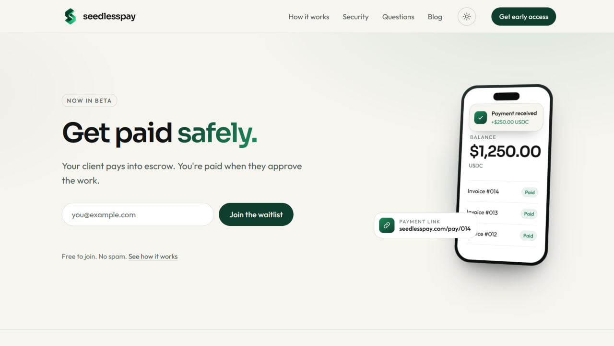
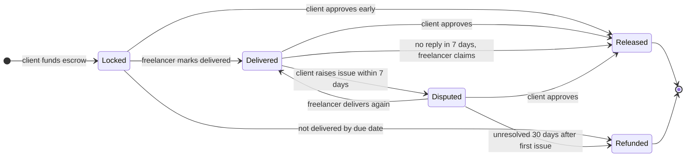
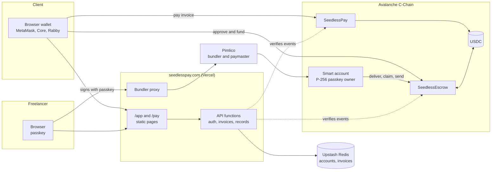

<p align="center">
  
</p>

<h1 align="center">SeedlessPay</h1>

<p align="center"><strong>Get paid safely.</strong><br>Your client pays into escrow. You're paid when they approve the work.</p>

<p align="center">
  <a href="https://seedlesspay.com"></a>
  
  
  <a href="https://testnet.snowtrace.io/address/0x62342f78ca904Aea8690f0F576426DD6E1b5936E/contract/43113/code"></a>
  
  <a href="LICENSE"></a>
</p>

<p align="center">
  <a href="https://seedlesspay.com">Website</a> ·
  <a href="https://seedlesspay.com/app">Try the beta</a> ·
  <a href="https://seedlesspay.com/blog">Blog</a> ·
  <a href="https://x.com/seedlesspay">X</a> ·
  <a href="https://t.me/seedlesspay">Telegram</a> ·
  <a href="https://www.linkedin.com/company/seedlesspay">LinkedIn</a>
</p>

<p align="center">
  
</p>

## What is SeedlessPay?

SeedlessPay helps freelancers get paid by clients anywhere in the world without the fear of not getting paid.

A freelancer sends an invoice link. The client pays the full amount in USDC into an escrow contract on Avalanche before the work starts. The money is released milestone by milestone when the client approves the work, or automatically after 7 days if the client says nothing. The freelancer's wallet opens with a passkey (Face ID or a fingerprint), so there is no seed phrase, no app to install and no network fee to pay.

> **Beta.** SeedlessPay runs on the Avalanche Fuji test network. Test USDC has no real value. The contracts have not been audited yet.

## Why it matters

Freelancers lose money in two ways: clients who pay late and clients who never pay. When the client is in another country, there is little a freelancer can do. Existing options either take a large share of every payment or hold the money themselves.

| | Sending a wallet address | Freelance marketplaces | **SeedlessPay** |
|---|---|---|---|
| Money committed before work starts | No | Yes | **Yes** |
| Who holds the money | Nobody, it is paid at once | The platform | **A public contract with no owner** |
| Freelancer protected if client goes silent | No | Depends on platform | **Yes, auto release after 7 days** |
| Client protected if work is not delivered | No | Depends on platform | **Yes, refund after due date** |
| Fees | Network fee | Often 5% to 20% | **None today, network fee covered** |
| Wallet setup | Seed phrase | Account and ID checks | **Passkey (Face ID)** |

## Features

**For freelancers** (`/app`)
- Wallet that opens with a passkey on any device, no seed phrase
- Invoices paid at once, or split into up to 5 escrow milestones
- Mark milestones delivered, claim after the review window, propose or accept splits
- Payment records verified on-chain, receipts and CSV export
- Send USDC with saved addresses, a review step and network warnings
- Network fees covered through a paymaster

**For clients** (`/pay/<id>`)
- Pay from any browser wallet (EIP-6963 wallet picker)
- See the milestone plan and due dates before paying
- Approve milestones, raise an issue, or take back undelivered milestones
- Only the wallet that paid can manage the escrow

## How escrow works



- Each milestone is settled on its own, so the freelancer is paid as the work progresses.
- Redelivering does not restart the 30 day dispute clock, so neither side can stall forever.
- The freelancer can return a milestone to the client at any time.
- While a milestone is open, either side can propose a split. It only happens when the other side accepts exactly the same numbers.

## Architecture



- **Passkey wallet.** Avalanche C-Chain verifies P-256 (secp256r1) signatures natively through the ACP-204 precompile, which makes WebAuthn wallets cheap to use. The freelancer's wallet is a Coinbase Smart Wallet owned by their passkey.
- **Gas sponsorship.** User operations go through an ERC-4337 bundler and paymaster (Pimlico). The API key stays on the server.
- **Verified records.** The server never trusts the browser. A payment, escrow funding or withdrawal is recorded only after the matching on-chain event is checked.

## Deployments

| Contract | Fuji testnet (43113) |
|---|---|
| SeedlessEscrow | [`0x62342f78ca904Aea8690f0F576426DD6E1b5936E`](https://testnet.snowtrace.io/address/0x62342f78ca904Aea8690f0F576426DD6E1b5936E) |
| SeedlessPay | [`0x6F6b2Fe036c6d4e74f45B4b80E3049Fc8d7CfBB3`](https://testnet.snowtrace.io/address/0x6F6b2Fe036c6d4e74f45B4b80E3049Fc8d7CfBB3) |
| USDC (Circle) | [`0x5425890298aed601595a70AB815c96711a31Bc65`](https://testnet.snowtrace.io/address/0x5425890298aed601595a70AB815c96711a31Bc65) |

Both SeedlessPay contracts are verified on Snowtrace (exact match).

**Proof on Fuji**
- [First passkey payment with sponsored gas](https://testnet.snowtrace.io/tx/0xa19ccabe4e9ed9ff1330d7ded4a33edeada2de23575a6389beb435ac8780f167)
- [First invoice paid from MetaMask](https://testnet.snowtrace.io/tx/0xa173b7230043ea79e3a40e5be7608ccd5231ca5584c3eb38ebfcfb0a1a6bf8e5)
- Full escrow cycle (fund, deliver, approve, paid) on the [escrow contract](https://testnet.snowtrace.io/address/0x62342f78ca904Aea8690f0F576426DD6E1b5936E)

## Repository

```
contracts/          Solidity contracts (Foundry)
  src/              SeedlessEscrow.sol, SeedlessPay.sol
  test/             52 tests, no external dependencies
  script/           deploy scripts
web/                website and app (plain HTML, CSS and JS, no build step)
  api/              Vercel functions: auth, invoices, records, bundler proxy
  js/               shared browser code
  blog/             guides for freelancers
docs/               images used in this README
```

## Contracts

### SeedlessEscrow

[`contracts/src/SeedlessEscrow.sol`](contracts/src/SeedlessEscrow.sol) holds an invoice's full amount and releases it milestone by milestone.

| Function | Who | What it does |
|---|---|---|
| `fund` / `fundWithPermit` | client | Locks the full amount for 1 to 5 milestones |
| `markDelivered` | freelancer | Starts the 7 day review, or delivers again after an issue |
| `approve` | client | Pays a milestone to the freelancer |
| `raiseIssue` | client | Stops auto release, starts the 30 day clock once |
| `claim` | freelancer | Takes a delivered milestone after 7 days without reply |
| `refund` | client | Takes back an overdue or deadlocked milestone |
| `returnToClient` | freelancer | Gives a milestone back at any time |
| `proposeSplit` / `acceptSplit` | either | Divides a milestone when both agree |

### SeedlessPay

[`contracts/src/SeedlessPay.sol`](contracts/src/SeedlessPay.sol) handles invoices paid at once. USDC moves from the client straight to the freelancer in one transfer, and the invoice is marked paid.

### Design principles

- **No owner, no admin key, no upgrades, no fees.** Nothing can be paused, redirected or changed after deployment.
- **Nobody can move funds outside the rules,** including the SeedlessPay team.
- **Cannot be blocked.** Invoices and escrows are keyed by the hash of their full terms, so funding the same id with different terms does not affect the real one.
- **Front-run safe permits.** If someone submits a client's permit signature first, the payment still goes through.

### Build and test

Requires [Foundry](https://book.getfoundry.sh/).

```sh
cd contracts
forge build
forge test -vvv
```

### Deploy

```sh
cd contracts
cast wallet import deployer --interactive   # encrypted keystore, never commit keys
forge script script/DeployEscrow.s.sol:DeployEscrow --rpc-url fuji --account deployer --broadcast
```

| Network | Chain ID | USDC |
|---|---|---|
| Fuji testnet | 43113 | `0x5425890298aed601595a70AB815c96711a31Bc65` |
| Avalanche C-Chain | 43114 | `0xB97EF9Ef8734C71904D8002F8b6Bc66Dd9c48a6E` |

## Web app

The site in [`web/`](web/) is plain HTML, CSS and JavaScript with no build step, hosted on Vercel with **Root Directory** set to `web`.

| Path | Purpose |
|---|---|
| `/` | Landing page and waitlist |
| `/app` | Freelancer app |
| `/pay/<id>` | Client payment page |
| `/blog` | Guides for freelancers |
| `/api/auth` | Passkey accounts and sessions |
| `/api/invoices` | Create invoices, verify payments and escrow funding |
| `/api/me` | Invoice list, saved addresses, withdrawals |
| `/api/bundler` | Pimlico proxy with a method allowlist |
| `/api/waitlist` | Waitlist signups |

**Environment variables (Vercel)**

| Name | Purpose |
|---|---|
| `KV_REST_API_URL`, `KV_REST_API_TOKEN` | Upstash Redis |
| `PIMLICO_API_KEY` | Bundler and paymaster |
| `PIMLICO_SPONSORSHIP_POLICY_ID` | Optional sponsorship policy |
| `FUJI_RPC_URL` | Optional custom RPC |

**Accounts and sessions.** The passkey's public key and wallet address are stored on the server so the same wallet opens on any device. Sign-in verifies a WebAuthn assertion with Node crypto: one-time challenge, origin and RP ID checks, and the user verification flag. Sessions are HttpOnly cookies, and state-changing requests must be same-origin.

**Records.** Invoices are kept for 2 years. Payments, escrow funding and withdrawals are recorded only after they are verified on-chain.

## Roadmap

- [x] Passkey wallet with sponsored gas
- [x] Invoices paid at once
- [x] Milestone escrow with review, refunds and splits
- [x] Verified records, receipts and CSV export
- [ ] Independent security review of the contracts
- [ ] Avalanche mainnet launch
- [ ] Card and bank payments for clients
- [ ] Cash out guides and partners for local currencies
- [ ] Per-milestone receipts and recurring invoices

## Security

SeedlessPay handles money, so we take security reports seriously. Please do **not** open a public issue for a vulnerability. See [SECURITY.md](SECURITY.md) for how to report one.

## Contributing

Bug reports and ideas are welcome. Read [CONTRIBUTING.md](CONTRIBUTING.md) and our [Code of Conduct](CODE_OF_CONDUCT.md) first.

## Founder

Built by [Sithu Nyein](https://sithunyein.com), a freelance developer from Myanmar who has lived the problem of getting paid by clients abroad.

Contact: [hello@seedlesspay.com](mailto:hello@seedlesspay.com)

## License

[MIT](LICENSE)
